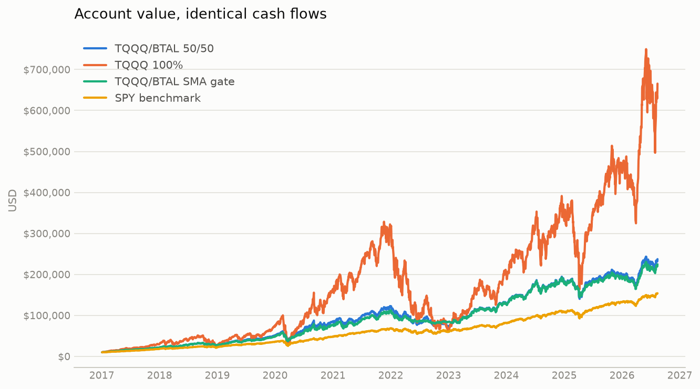
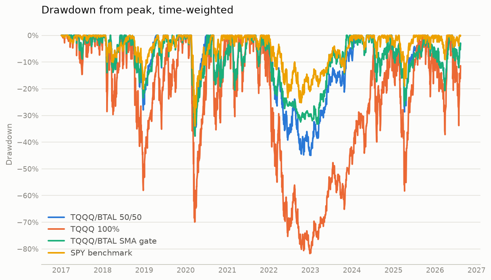
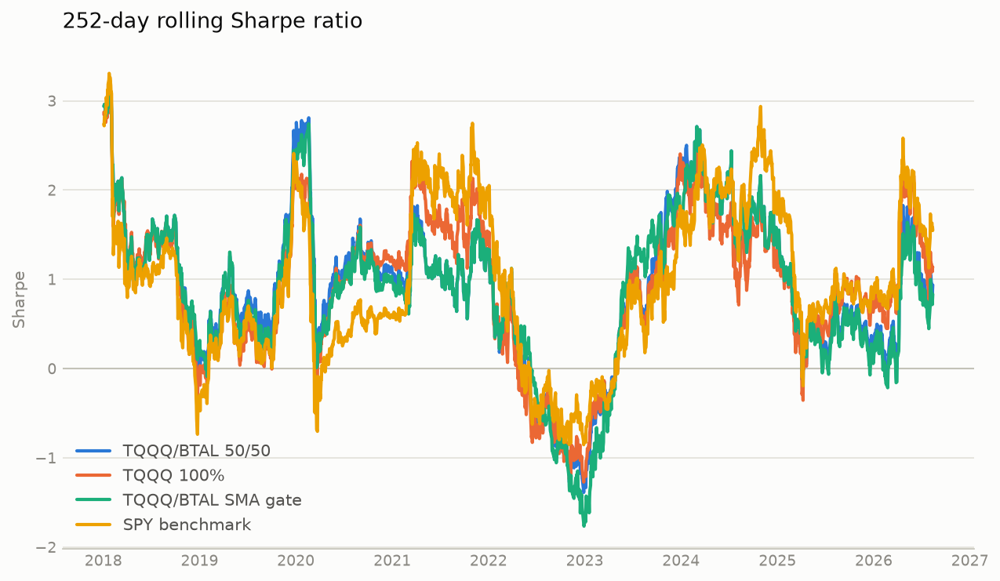
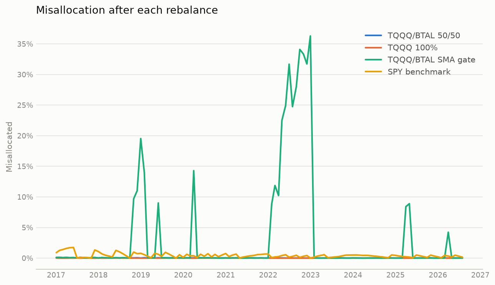

# Portfolio strategy comparison

Simulated 2017-01-03 to 2026-08-13.

| | TQQQ/BTAL 50/50 | TQQQ 100% | TQQQ/BTAL SMA gate | SPY benchmark |
|---|---:|---:|---:|---:|
| Final value | $237,334.67 | $665,555.35 | $224,781.82 | $154,096.56 |
| Total contributed | $67,500.00 | $67,500.00 | $67,500.00 | $67,500.00 |
| Net profit | $169,834.67 | $598,055.35 | $157,281.82 | $86,596.56 |
| Net profit % | +251.61% | +886.01% | +233.01% | +128.29% |
| CAGR (TWR) | +23.67% | +41.70% | +22.70% | +13.71% |
| XIRR (money-weighted) | +21.79% | +39.51% | +20.87% | +14.44% |
| Volatility (annualised) | 28.72% | 67.65% | 25.56% | 18.20% |
| Sharpe | 0.89 | 0.86 | 0.93 | 0.80 |
| Sortino | 1.25 | 1.22 | 1.30 | 1.12 |
| Calmar | 0.53 | 0.51 | 0.60 | 0.40 |
| Max drawdown | -44.97% | -81.75% | -37.73% | -33.97% |
| Max drawdown days | 757 | 1,118 | 138 | 181 |
| Best year | 2023: +65.1% | 2023: +193.1% | 2017: +46.6% | 2019: +28.7% |
| Worst year | 2022: -42.9% | 2022: -79.2% | 2022: -29.2% | 2022: -19.4% |
| Avg misallocation | 0.03% | 0.01% | 3.45% | 0.45% |
| Max misallocation | 0.12% | 0.02% | 36.29% | 1.74% |
| Avg worst-asset dev | 0.02% | 0.01% | 3.44% | 0.45% |
| Max worst-asset dev | 0.11% | 0.02% | 36.29% | 1.74% |

## Account value

## Drawdown

## Rolling Sharpe

## Imbalance

## Top drawdowns — TQQQ/BTAL 50/50

| Peak | Trough | Recovery | Depth | Days |
|---|---|---|---:|---:|
| 2021-12-27 | 2023-01-05 | 2024-01-23 | -44.97% | 757 |
| 2020-02-19 | 2020-03-23 | 2020-07-01 | -37.73% | 133 |
| 2024-12-16 | 2025-04-08 | 2025-09-19 | -28.66% | 277 |
| 2018-08-29 | 2018-12-24 | 2019-04-17 | -27.93% | 231 |
| 2025-10-29 | 2026-03-27 | 2026-05-05 | -20.67% | 188 |

## Top drawdowns — TQQQ 100%

| Peak | Trough | Recovery | Depth | Days |
|---|---|---|---:|---:|
| 2021-11-19 | 2022-12-28 | 2024-12-11 | -81.75% | 1,118 |
| 2020-02-19 | 2020-03-20 | 2020-07-10 | -69.92% | 142 |
| 2024-12-16 | 2025-04-08 | 2025-08-12 | -58.30% | 239 |
| 2018-08-29 | 2018-12-24 | 2019-11-05 | -58.08% | 433 |
| 2025-10-29 | 2026-03-30 | 2026-04-24 | -37.17% | 177 |

## Top drawdowns — TQQQ/BTAL SMA gate

| Peak | Trough | Recovery | Depth | Days |
|---|---|---|---:|---:|
| 2020-02-19 | 2020-03-23 | 2020-07-06 | -37.73% | 138 |
| 2021-12-27 | 2023-03-10 | 2023-11-14 | -33.21% | 687 |
| 2024-12-16 | 2025-04-08 | 2025-10-08 | -26.31% | 296 |
| 2018-08-29 | 2018-12-24 | 2019-04-23 | -23.43% | 237 |
| 2025-10-29 | 2026-03-27 | 2026-05-06 | -20.67% | 189 |

## Top drawdowns — SPY benchmark

| Peak | Trough | Recovery | Depth | Days |
|---|---|---|---:|---:|
| 2020-02-19 | 2020-03-23 | 2020-08-18 | -33.97% | 181 |
| 2022-01-03 | 2022-10-12 | 2024-01-19 | -25.24% | 746 |
| 2018-09-20 | 2018-12-24 | 2019-04-29 | -20.09% | 221 |
| 2025-02-19 | 2025-04-08 | 2025-06-27 | -18.95% | 128 |
| 2018-01-26 | 2018-04-02 | 2018-08-24 | -10.10% | 210 |

- Daily-return correlation, TQQQ/BTAL 50/50 to SPY benchmark: 0.87
- Daily-return correlation, TQQQ 100% to SPY benchmark: 0.93
- Daily-return correlation, TQQQ/BTAL SMA gate to SPY benchmark: 0.79
