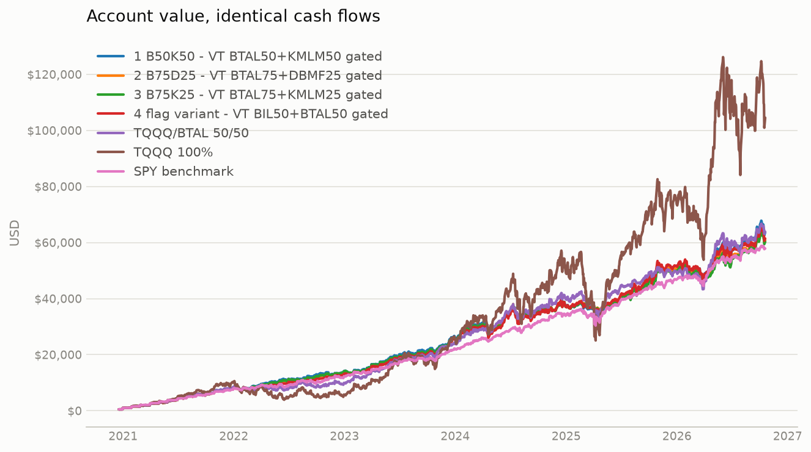
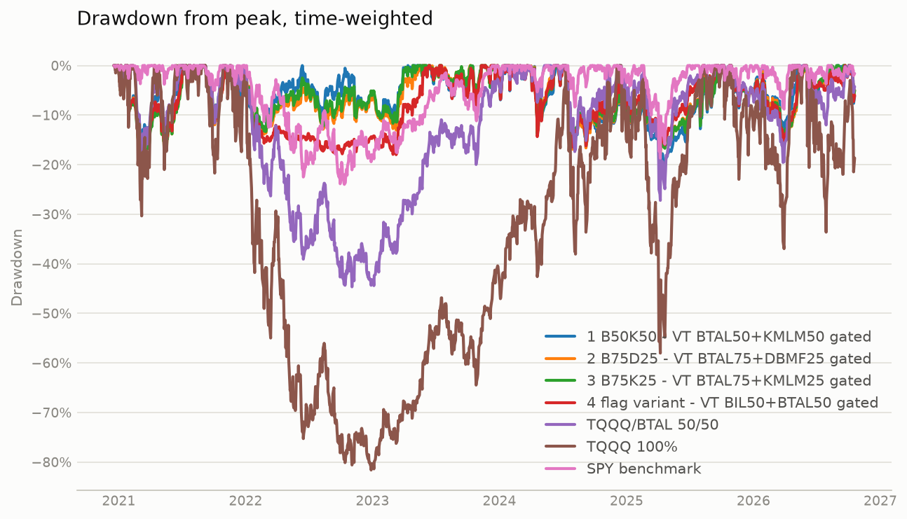
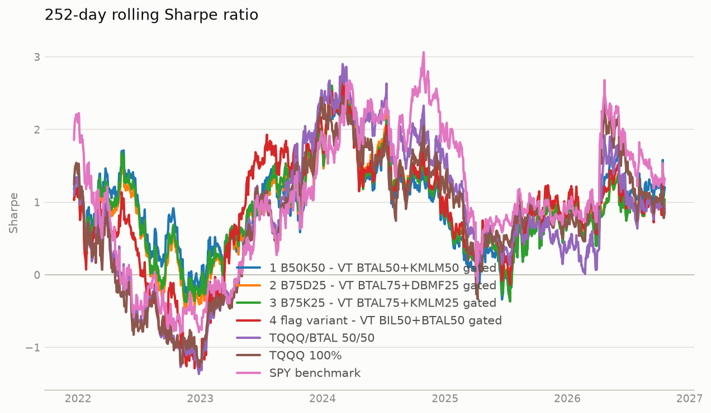
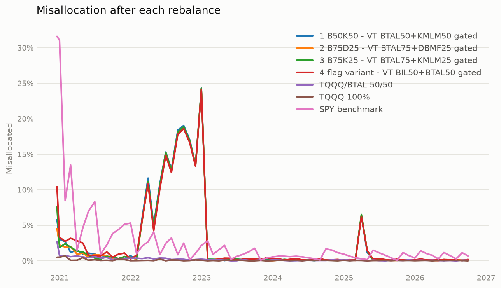

# Portfolio strategy comparison

Simulated 2020-12-18 to 2026-10-19.

Reproduce at commit `9c649ed`:

```
uv run main.py --spec specs/top_strategies_2021.json --md simulation/top/top2021/results.md --charts simulation/top/top2021/ --tx simulation/top/top2021/transactions.md
```

Commit: 9c649ed (dirty: specs/top_strategies_2021.json)

Generated: 2026-10-19 20:59 UTC

<details><summary>Spec as run: specs/top_strategies_2021.json</summary>

```json
{
  "schema_version": 1,
  "config": {
    "start": "2020-12-18",
    "initial_capital": 500,
    "monthly_contribution": 500,
    "cost_bps": {
      "TQQQ": 1.5,
      "BTAL": 6,
      "DBMF": 2.5,
      "KMLM": 6,
      "QQQ": 1,
      "SPY": 0.7,
      "BIL": 0.5,
      "*": 6
    },
    "cash_yield": 0.03
  },
  "strategies": [
    {
      "type": "vol_target",
      "label": "1 B50K50 - VT BTAL50+KMLM50 gated",
      "risk": "TQQQ",
      "safe": {
        "BTAL": 0.5,
        "KMLM": 0.5
      },
      "vol_symbol": "QQQ",
      "vol": {
        "kind": "ewma",
        "lam": 0.8
      },
      "leverage": 3,
      "sigma_target": 0.2,
      "w_max": 0.8,
      "gate": {
        "symbol": "QQQ",
        "assets": [
          "TQQQ"
        ],
        "sma_days": 200
      }
    },
    {
      "type": "vol_target",
      "label": "2 B75D25 - VT BTAL75+DBMF25 gated",
      "risk": "TQQQ",
      "safe": {
        "BTAL": 0.75,
        "DBMF": 0.25
      },
      "vol_symbol": "QQQ",
      "vol": {
        "kind": "ewma",
        "lam": 0.8
      },
      "leverage": 3,
      "sigma_target": 0.2,
      "w_max": 0.8,
      "gate": {
        "symbol": "QQQ",
        "assets": [
          "TQQQ"
        ],
        "sma_days": 200
      }
    },
    {
      "type": "vol_target",
      "label": "3 B75K25 - VT BTAL75+KMLM25 gated",
      "risk": "TQQQ",
      "safe": {
        "BTAL": 0.75,
        "KMLM": 0.25
      },
      "vol_symbol": "QQQ",
      "vol": {
        "kind": "ewma",
        "lam": 0.8
      },
      "leverage": 3,
      "sigma_target": 0.2,
      "w_max": 0.8,
      "gate": {
        "symbol": "QQQ",
        "assets": [
          "TQQQ"
        ],
        "sma_days": 200
      }
    },
    {
      "type": "vol_target",
      "label": "4 flag variant - VT BIL50+BTAL50 gated",
      "risk": "TQQQ",
      "safe": {
        "BIL": 0.5,
        "BTAL": 0.5
      },
      "vol_symbol": "QQQ",
      "vol": {
        "kind": "ewma",
        "lam": 0.8
      },
      "leverage": 3,
      "sigma_target": 0.2,
      "w_max": 0.8,
      "gate": {
        "symbol": "QQQ",
        "assets": [
          "TQQQ"
        ],
        "sma_days": 200
      }
    },
    {
      "type": "fixed",
      "label": "TQQQ/BTAL 50/50",
      "weights": { "TQQQ": 0.5, "BTAL": 0.5 }
    },
    {
      "type": "fixed",
      "label": "TQQQ 100%",
      "weights": { "TQQQ": 1.0 }
    },
    {
      "type": "fixed",
      "label": "SPY benchmark",
      "weights": {
        "SPY": 1.0
      }
    }
  ]
}
```

</details>

| | 1 B50K50 - VT BTAL50+KMLM50 gated | 2 B75D25 - VT BTAL75+DBMF25 gated | 3 B75K25 - VT BTAL75+KMLM25 gated | 4 flag variant - VT BIL50+BTAL50 gated | TQQQ/BTAL 50/50 | TQQQ 100% | SPY benchmark |
|---|---:|---:|---:|---:|---:|---:|---:|
| Final value | $63,613.99 | $60,783.64 | $60,259.64 | $61,441.65 | $63,864.21 | $104,551.86 | $57,880.95 |
| Total contributed | $35,500.00 | $35,500.00 | $35,500.00 | $35,500.00 | $35,500.00 | $35,500.00 | $35,500.00 |
| Net profit | $28,113.99 | $25,283.64 | $24,759.64 | $25,941.65 | $28,364.21 | $69,051.86 | $22,380.95 |
| Net profit % | +79.19% | +71.22% | +69.75% | +73.08% | +79.90% | +194.51% | +63.04% |
| CAGR (TWR) | +19.47% | +17.26% | +17.20% | +16.82% | +15.74% | +23.40% | +14.60% |
| XIRR (money-weighted) | +19.78% | +18.22% | +17.92% | +18.59% | +19.92% | +37.15% | +16.55% |
| Volatility (annualised) | 20.91% | 20.27% | 20.04% | 20.17% | 26.71% | 66.30% | 16.22% |
| Sharpe | 0.96 | 0.89 | 0.90 | 0.88 | 0.68 | 0.65 | 0.93 |
| Sortino | 1.34 | 1.25 | 1.26 | 1.23 | 0.97 | 0.93 | 1.35 |
| Calmar | 0.94 | 0.92 | 0.91 | 0.93 | 0.35 | 0.29 | 0.61 |
| Max drawdown | -20.75% | -18.81% | -18.82% | -18.03% | -44.65% | -81.61% | -23.98% |
| Max drawdown days | 448 | 167 | 169 | 162 | 750 | 1,111 | 708 |
| Best year | 2023: +37.2% | 2023: +33.9% | 2023: +35.0% | 2023: +40.3% | 2023: +70.8% | 2023: +197.8% | 2021: +27.3% |
| Worst year | 2022: -2.5% | 2022: -5.8% | 2022: -4.4% | 2022: -12.9% | 2022: -42.3% | 2022: -79.0% | 2022: -17.7% |
| Avg misallocation | 2.63% | 2.56% | 2.61% | 2.77% | 0.22% | 0.09% | 2.66% |
| Max misallocation | 24.31% | 24.26% | 24.29% | 24.15% | 2.71% | 0.69% | 31.61% |
| Avg worst-asset dev | 2.46% | 2.43% | 2.43% | 2.58% | 0.16% | 0.09% | 2.66% |
| Max worst-asset dev | 24.31% | 24.27% | 24.29% | 24.15% | 2.48% | 0.69% | 31.61% |
| Avg weight BIL |  |  |  | 0.31 |  |  |  |
| Avg weight BTAL | 0.31 | 0.46 | 0.46 | 0.31 | 0.50 |  |  |
| Avg weight DBMF |  | 0.15 |  |  |  |  |  |
| Avg weight KMLM | 0.31 |  | 0.15 |  |  |  |  |
| Avg weight SPY |  |  |  |  |  |  | 0.97 |
| Avg weight TQQQ | 0.38 | 0.38 | 0.38 | 0.38 | 0.50 | 1.00 |  |
| Turnover (1-sided, ann.) | 1.75 | 1.75 | 1.75 | 1.77 | 0.49 | 0.09 | 0.13 |
| Total fees | $203.23 | $176.23 | $198.83 | $126.35 | $56.06 | $5.32 | $2.46 |

## Account value



## Drawdown



## Rolling Sharpe



## Imbalance



## Top drawdowns — 1 B50K50 - VT BTAL50+KMLM50 gated

| Peak | Trough | Recovery | Depth | Days |
|---|---|---|---:|---:|
| 2024-07-10 | 2025-04-08 | 2025-10-01 | -20.75% | 448 |
| 2021-01-26 | 2021-03-08 | 2021-07-02 | -15.99% | 157 |
| 2021-11-19 | 2022-01-27 | 2022-06-13 | -14.72% | 206 |
| 2025-10-29 | 2026-03-27 | 2026-05-08 | -14.52% | 191 |
| 2024-03-22 | 2024-04-19 | 2024-06-12 | -13.82% | 82 |

## Top drawdowns — 2 B75D25 - VT BTAL75+DBMF25 gated

| Peak | Trough | Recovery | Depth | Days |
|---|---|---|---:|---:|
| 2021-01-26 | 2021-03-08 | 2021-07-12 | -18.81% | 167 |
| 2024-07-10 | 2025-04-08 | 2025-09-22 | -18.09% | 439 |
| 2025-10-29 | 2026-03-27 | 2026-06-01 | -16.10% | 215 |
| 2021-11-19 | 2022-02-23 | 2023-05-18 | -13.85% | 545 |
| 2024-03-22 | 2024-04-19 | 2024-06-05 | -13.72% | 75 |

## Top drawdowns — 3 B75K25 - VT BTAL75+KMLM25 gated

| Peak | Trough | Recovery | Depth | Days |
|---|---|---|---:|---:|
| 2021-01-26 | 2021-03-08 | 2021-07-14 | -18.82% | 169 |
| 2024-07-10 | 2025-04-08 | 2025-10-01 | -17.49% | 448 |
| 2025-10-29 | 2026-03-27 | 2026-06-01 | -15.94% | 215 |
| 2024-03-22 | 2024-04-19 | 2024-06-10 | -13.73% | 80 |
| 2021-11-19 | 2022-02-28 | 2023-04-27 | -13.33% | 524 |

## Top drawdowns — 4 flag variant - VT BIL50+BTAL50 gated

| Peak | Trough | Recovery | Depth | Days |
|---|---|---|---:|---:|
| 2021-01-26 | 2021-05-12 | 2021-07-07 | -18.03% | 162 |
| 2021-11-19 | 2023-03-10 | 2023-06-12 | -17.99% | 570 |
| 2024-07-10 | 2025-04-08 | 2025-08-08 | -17.12% | 394 |
| 2025-10-29 | 2026-03-30 | 2026-05-26 | -16.79% | 209 |
| 2024-03-22 | 2024-04-19 | 2024-06-10 | -14.35% | 80 |

## Top drawdowns — TQQQ/BTAL 50/50

| Peak | Trough | Recovery | Depth | Days |
|---|---|---|---:|---:|
| 2021-12-27 | 2022-11-03 | 2024-01-16 | -44.65% | 750 |
| 2024-12-16 | 2025-04-08 | 2025-08-12 | -27.21% | 239 |
| 2021-02-12 | 2021-03-08 | 2021-06-28 | -20.41% | 136 |
| 2025-10-29 | 2026-03-27 | 2026-05-01 | -19.54% | 184 |
| 2024-07-10 | 2024-08-05 | 2024-12-11 | -17.36% | 154 |

## Top drawdowns — TQQQ 100%

| Peak | Trough | Recovery | Depth | Days |
|---|---|---|---:|---:|
| 2021-11-19 | 2022-12-28 | 2024-12-04 | -81.61% | 1,111 |
| 2024-12-16 | 2025-04-08 | 2025-08-12 | -58.02% | 239 |
| 2025-10-29 | 2026-03-30 | 2026-04-22 | -36.95% | 175 |
| 2026-06-02 | 2026-07-29 | ongoing | -33.62% | - |
| 2021-02-12 | 2021-03-08 | 2021-04-13 | -30.34% | 60 |

## Top drawdowns — SPY benchmark

| Peak | Trough | Recovery | Depth | Days |
|---|---|---|---:|---:|
| 2022-01-03 | 2022-10-12 | 2023-12-12 | -23.98% | 708 |
| 2025-02-19 | 2025-04-08 | 2025-06-26 | -18.69% | 127 |
| 2026-01-27 | 2026-03-30 | 2026-04-14 | -8.79% | 77 |
| 2024-07-16 | 2024-08-05 | 2024-09-19 | -8.38% | 65 |
| 2024-03-27 | 2024-04-19 | 2024-05-14 | -5.32% | 48 |

- Daily-return correlation, 1 B50K50 - VT BTAL50+KMLM50 gated to SPY benchmark: 0.52
- Daily-return correlation, 2 B75D25 - VT BTAL75+DBMF25 gated to SPY benchmark: 0.49
- Daily-return correlation, 3 B75K25 - VT BTAL75+KMLM25 gated to SPY benchmark: 0.47
- Daily-return correlation, 4 flag variant - VT BIL50+BTAL50 gated to SPY benchmark: 0.60
- Daily-return correlation, TQQQ/BTAL 50/50 to SPY benchmark: 0.89
- Daily-return correlation, TQQQ 100% to SPY benchmark: 0.94
