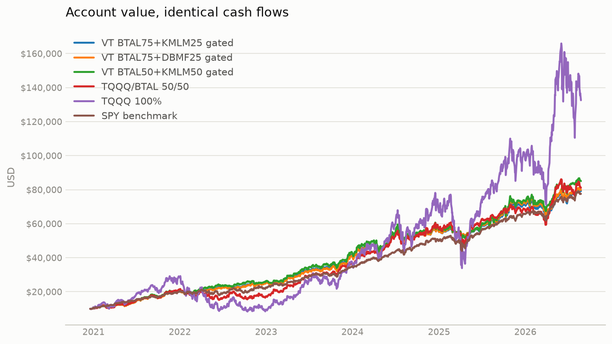
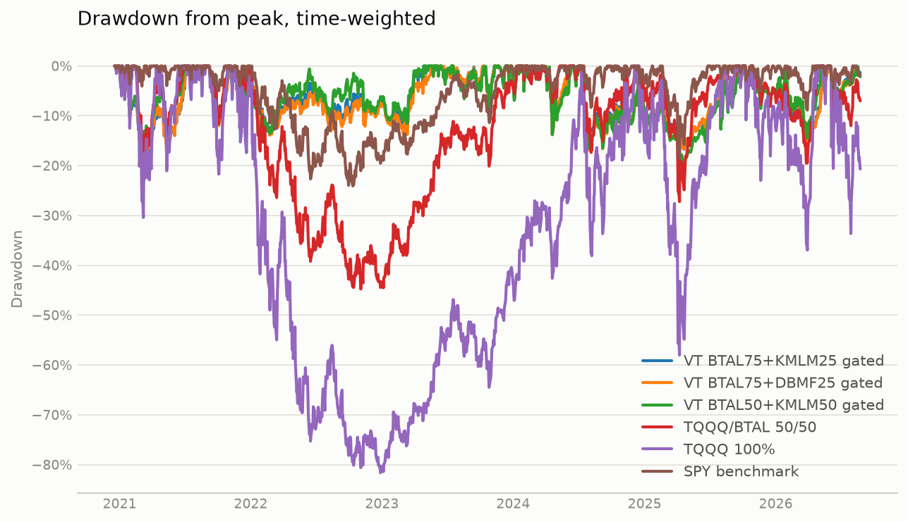
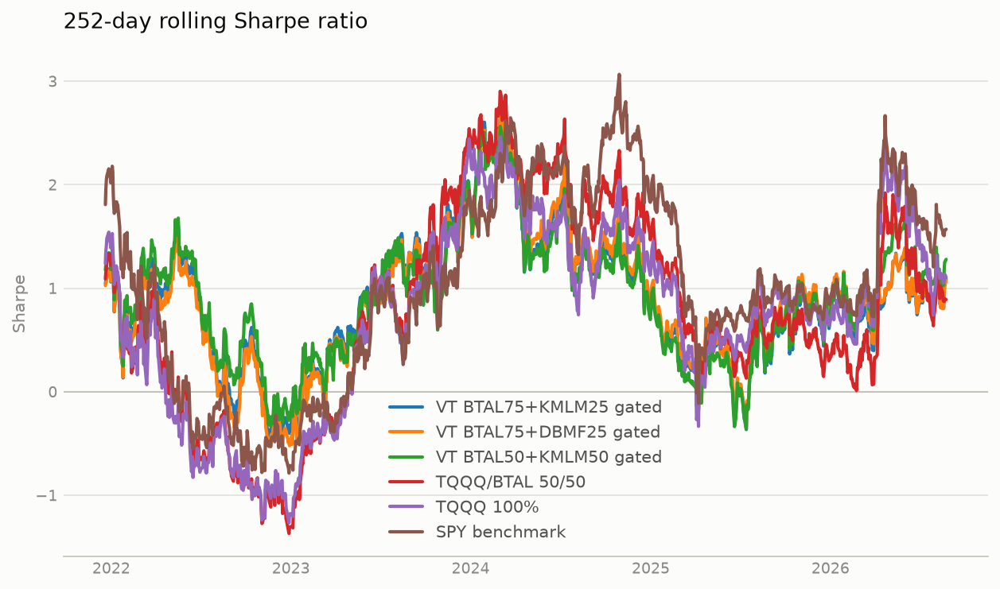
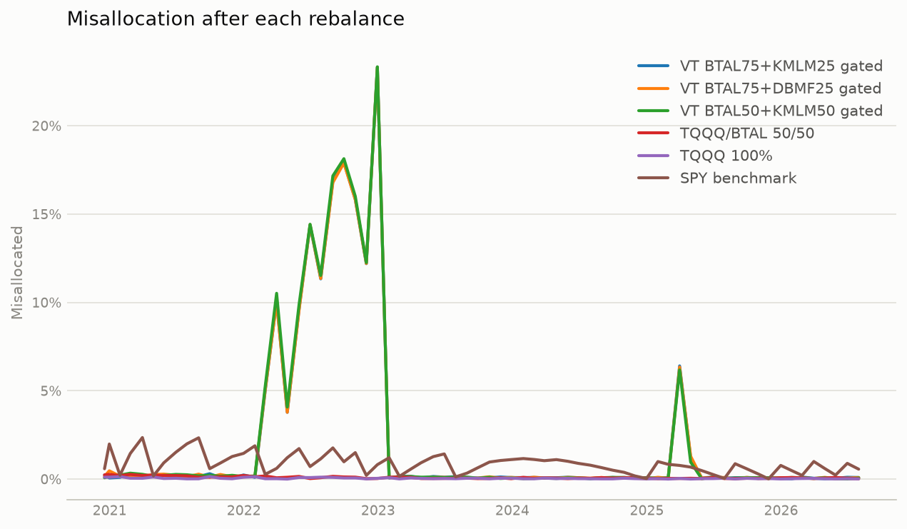

# Portfolio strategy comparison

Simulated 2020-12-18 to 2026-08-24.

| | VT BTAL75+KMLM25 gated | VT BTAL75+DBMF25 gated | VT BTAL50+KMLM50 gated | TQQQ/BTAL 50/50 | TQQQ 100% | SPY benchmark |
|---|---:|---:|---:|---:|---:|---:|
| Final value | $79,186.02 | $79,927.82 | $85,069.98 | $81,097.66 | $132,583.64 | $77,537.79 |
| Total contributed | $44,000.00 | $44,000.00 | $44,000.00 | $44,000.00 | $44,000.00 | $44,000.00 |
| Net profit | $35,186.02 | $35,927.82 | $41,069.98 | $37,097.66 | $88,583.64 | $33,537.79 |
| Net profit % | +79.97% | +81.65% | +93.34% | +84.31% | +201.33% | +76.22% |
| CAGR (TWR) | +16.60% | +16.69% | +18.94% | +15.19% | +23.55% | +15.06% |
| XIRR (money-weighted) | +16.90% | +17.17% | +18.99% | +17.59% | +32.20% | +16.29% |
| Volatility (annualised) | 20.07% | 20.32% | 20.95% | 26.96% | 66.76% | 16.55% |
| Sharpe | 0.87 | 0.87 | 0.94 | 0.66 | 0.65 | 0.93 |
| Sortino | 1.21 | 1.21 | 1.31 | 0.94 | 0.94 | 1.36 |
| Calmar | 0.87 | 0.88 | 0.91 | 0.34 | 0.29 | 0.63 |
| Max drawdown | -19.06% | -19.04% | -20.79% | -44.77% | -81.63% | -24.08% |
| Max drawdown days | 169 | 167 | 448 | 750 | 1,111 | 708 |
| Best year | 2023: +35.4% | 2023: +34.4% | 2023: +37.7% | 2023: +70.9% | 2023: +198.0% | 2021: +28.4% |
| Worst year | 2022: -5.6% | 2022: -7.0% | 2022: -3.8% | 2022: -42.5% | 2022: -79.1% | 2022: -17.8% |
| Avg misallocation | 2.23% | 2.23% | 2.26% | 0.09% | 0.04% | 0.87% |
| Max misallocation | 23.31% | 23.31% | 23.34% | 0.27% | 0.15% | 2.35% |
| Avg worst-asset dev | 2.19% | 2.19% | 2.22% | 0.06% | 0.04% | 0.87% |
| Max worst-asset dev | 23.31% | 23.31% | 23.34% | 0.17% | 0.15% | 2.35% |
| Avg weight BTAL | 0.47 | 0.47 | 0.31 | 0.50 |  |  |
| Avg weight DBMF |  | 0.15 |  |  |  |  |
| Avg weight KMLM | 0.16 |  | 0.31 |  |  |  |
| Avg weight SPY |  |  |  |  |  | 0.99 |
| Avg weight TQQQ | 0.38 | 0.38 | 0.38 | 0.50 | 1.00 |  |
| Turnover (1-sided, ann.) | 1.70 | 1.70 | 1.70 | 0.51 | 0.08 | 0.10 |
| Total fees | $290.38 | $256.13 | $302.00 | $83.29 | $6.60 | $3.05 |

## Account value

## Drawdown

## Rolling Sharpe

## Imbalance

## Top drawdowns — VT BTAL75+KMLM25 gated

| Peak | Trough | Recovery | Depth | Days |
|---|---|---|---:|---:|
| 2021-01-26 | 2021-03-08 | 2021-07-14 | -19.06% | 169 |
| 2024-07-10 | 2025-04-08 | 2025-10-01 | -17.54% | 448 |
| 2025-10-29 | 2026-03-27 | 2026-06-01 | -15.94% | 215 |
| 2024-03-22 | 2024-04-19 | 2024-06-10 | -13.74% | 80 |
| 2021-11-19 | 2022-01-27 | 2023-04-28 | -13.39% | 525 |

## Top drawdowns — VT BTAL75+DBMF25 gated

| Peak | Trough | Recovery | Depth | Days |
|---|---|---|---:|---:|
| 2021-01-26 | 2021-03-08 | 2021-07-12 | -19.04% | 167 |
| 2024-07-10 | 2025-04-08 | 2025-09-22 | -18.10% | 439 |
| 2025-10-29 | 2026-03-27 | 2026-06-01 | -16.11% | 215 |
| 2021-11-19 | 2022-02-23 | 2023-05-18 | -13.91% | 545 |
| 2024-03-22 | 2024-04-19 | 2024-06-05 | -13.73% | 75 |

## Top drawdowns — VT BTAL50+KMLM50 gated

| Peak | Trough | Recovery | Depth | Days |
|---|---|---|---:|---:|
| 2024-07-10 | 2025-04-08 | 2025-10-01 | -20.79% | 448 |
| 2021-01-26 | 2021-03-08 | 2021-07-02 | -16.13% | 157 |
| 2021-11-19 | 2022-01-27 | 2023-04-27 | -14.83% | 524 |
| 2025-10-29 | 2026-03-27 | 2026-05-08 | -14.51% | 191 |
| 2024-03-22 | 2024-04-19 | 2024-06-12 | -13.82% | 82 |

## Top drawdowns — TQQQ/BTAL 50/50

| Peak | Trough | Recovery | Depth | Days |
|---|---|---|---:|---:|
| 2021-12-27 | 2022-11-03 | 2024-01-16 | -44.77% | 750 |
| 2024-12-16 | 2025-04-08 | 2025-08-12 | -27.22% | 239 |
| 2021-02-12 | 2021-03-08 | 2021-06-28 | -20.46% | 136 |
| 2025-10-29 | 2026-03-27 | 2026-04-30 | -19.54% | 183 |
| 2024-07-10 | 2024-08-05 | 2024-12-11 | -17.35% | 154 |

## Top drawdowns — TQQQ 100%

| Peak | Trough | Recovery | Depth | Days |
|---|---|---|---:|---:|
| 2021-11-19 | 2022-12-28 | 2024-12-04 | -81.63% | 1,111 |
| 2024-12-16 | 2025-04-08 | 2025-08-12 | -58.03% | 239 |
| 2025-10-29 | 2026-03-30 | 2026-04-22 | -36.96% | 175 |
| 2026-06-02 | 2026-07-29 | ongoing | -33.63% | - |
| 2021-02-12 | 2021-03-08 | 2021-04-13 | -30.41% | 60 |

## Top drawdowns — SPY benchmark

| Peak | Trough | Recovery | Depth | Days |
|---|---|---|---:|---:|
| 2022-01-03 | 2022-10-12 | 2023-12-12 | -24.08% | 708 |
| 2025-02-19 | 2025-04-08 | 2025-06-26 | -18.61% | 127 |
| 2026-01-27 | 2026-03-30 | 2026-04-14 | -8.86% | 77 |
| 2024-07-16 | 2024-08-05 | 2024-09-19 | -8.34% | 65 |
| 2024-03-27 | 2024-04-19 | 2024-05-14 | -5.30% | 48 |

- Daily-return correlation, VT BTAL75+KMLM25 gated to SPY benchmark: 0.49
- Daily-return correlation, VT BTAL75+DBMF25 gated to SPY benchmark: 0.51
- Daily-return correlation, VT BTAL50+KMLM50 gated to SPY benchmark: 0.54
- Daily-return correlation, TQQQ/BTAL 50/50 to SPY benchmark: 0.90
- Daily-return correlation, TQQQ 100% to SPY benchmark: 0.94
